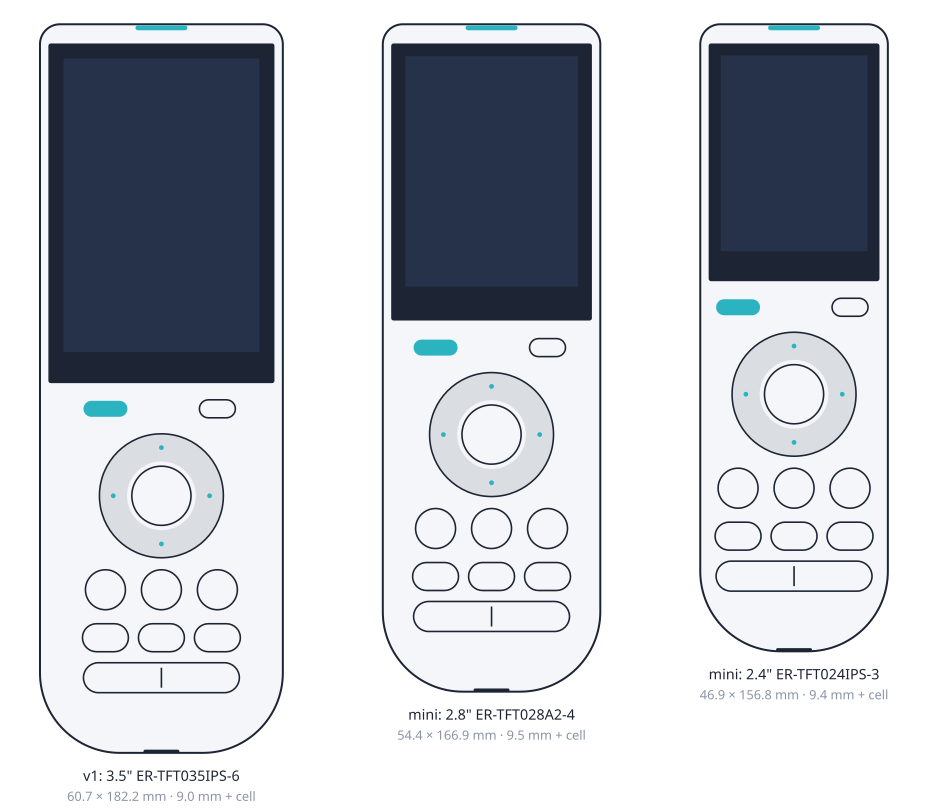

# Bleep mini — first investigation (2026-10-10, superseded by the designs in ../mini28 and ../mini24)

A smaller Bleep: narrower, with a ~2.8" screen, same design language (Pebble shape, 5 mm top / 20 mm bottom corners, IR window in the top wall, sensor window + power key in a row under the screen, D-pad ring, round keys, app pills, split volume bar, blue PETG windows, 2c Flat UI). This folder is only the investigation so far. v1 (`../hardware/`) is untouched and stays locked.

**3D:** https://claude.ai/artifact/69ZecfzMPNg2zRDwSh2ieR shows v1 next to both minis: 3/4, top, end-on and side views, X-ray, and the v1 studio's colour presets. `variants.py` makes the models. It runs v1's `layout.py` with only the panel, cell and a few clash fixes swapped in, writes `build/<variant>/params.scad` and runs v1's own fit checks. `variants.py --meshes` then builds them with v1's `remote.scad` into `viewer/<variant>.json`. The 2.8" concept passes every v1 fit check (54.4 × 167.8 × 14.5 mm). The 2.4" one fails on the antenna (section 3).

**Print (fit-and-feel mock-ups):** `print/bleep_mini_shells_X2D.3mf` holds the front shell and back plate of both minis on one Bambu Lab X2D plate. They are four separate objects in v1's print orientations (front shell face down, back plate flat). The row is 226.6 mm wide, inside the X2D's 235.5 mm dual-nozzle width. The same parts are also in `print/` as single STLs, and as one merged plate STL. Rebuild with `python3 variants.py && python3 print_plate.py`. No board exists for these yet, so they're for holding and comparing, not assembly.

`concepts/outline.py` draws v1 and the two candidate panels with **v1's own rules** (wall, clearance, end zones, key layout, read from `../hardware/layout.py`); it reproduces v1's 60.7 × 182.2 mm exactly, so the mini numbers are on the same basis.

| | v1 (3.5") | mini 2.8" | mini 2.4" |
|---|---|---|---|
| Panel | ER-TFT035IPS-6 + ER-TPC035-6 | ER-TFT028A2-4 + ER-TPC028-4.1 | ER-TFT024IPS-3 + ER-TPC024-1 |
| Shell width | 60.7 | **54.4** (−6.3, −10 %) | **46.9** (−13.8, −23 %) |
| Shell length | 182.2 | ≈ 167 | ≈ 157 |
| Thickness | 9.0 + cell (13.0 with 4 mm) | 9.5 + cell | 9.4 + cell |
| Board width | 53.9 | ≈ 47.6 | ≈ 40.1 |
| Cell bay under screen | 50.8 × 86.1 | ≈ 45 × 70 | ≈ 38 × 61 |

## 1. Displays

There is **no off-the-shelf 2.8" 320×480** panel with an MCU (8080/SPI) interface. Searched BuyDisplay, LCSC, Waveshare, Elecrow, Focus, Newhaven, 4D, AliExpress. Every small high-density panel (480×640, 360×640, 480×854) is ST7701S RGB-only: ~20 GPIOs + a PSRAM framebuffer + a 9 V backlight boost, which doesn't fit the ESP32-S3's pin budget. So any mini is **240×320**, and the UI needs re-laying-out either way (section 5).

| | **ER-TFT028A2-4 + ER-TPC028-4.1** (2.8") | ER-TFT024IPS-3 + ER-TPC024-1 (2.4") |
|---|---|---|
| Price (BuyDisplay, archived page) | $7.08 + $5.36 touch + $0.29 ZIF | $6.37 + $4.43 touch + $0.29 ZIF |
| Controller | ILI9341, IPS, 350 cd/m² | ST7789V, IPS, 300 cd/m² |
| Pixel pitch | 0.18 mm (141 ppi: everything 18 % bigger than v1) | 0.153 mm (166 ppi: identical to v1) |
| Outline | LCD 50.2 × 69.3 × 2.8 (wider than its glass); glass 49.5 × 69.2 | 42.72 × 59.46 |
| Total thickness | **4.30** ± 0.2 (v1: 3.75) | ≈ 4.2 |
| Cover | **glass, 6H** | **PET film, 3H** (P+G): scratches in a pocket |
| Interfaces on the FPC | 8080 8/9/16/18-bit, 3/4-wire SPI, RGB (IM0–3 on pins 6–9) | same |
| FPC | 50-pin 0.5 mm, 37.9 mm long (v1: 30) | 50-pin 0.5 mm, pin-out almost v1's |
| Touch | FT6206 @ 0x38 on a **separate 6-pin 0.5 mm tail** (26.7 mm) → second ZIF | FT6336U @ 0x38 on pins 44–47 of the same FPC (likely; confirm) |
| Backlight | 4 LEDs parallel, 3.2 V, **70 mA** (v1: 120 mA), common cathode on pin 1, 4 separate anodes | 4 LEDs, 3.2 V, 70 mA, common anode |

Datasheets are in `docs/` (from the Wayback Machine; BuyDisplay's live site is behind Cloudflare, so confirm prices at checkout).

Ruled out: ER-TFT028A3-4 (TN), Adafruit 2770 (TN), Waveshare 2.8" (module, not a bare panel), Focus E28RA / Newhaven / 4D (€55–80, mostly out of stock, no advantage), AliExpress 40-pin 2.8" IPS ST7789 panels (≈ €4–6 + €3 import each, specs unverified: a sample buy only).

**Recommendation: ER-TFT028A2-4** — it's the size you asked for and has a real glass cover. The catch: it only buys 6.3 mm of width, because the stock 2.8" outline (50.2 mm) is just 6.3 mm narrower than v1's glass. The 2.4" is the one that makes the remote *noticeably* slimmer (47 mm, about a Chromecast / Apple TV remote width), at the cost of a plastic cover and a cramped key cluster (the app pills come within ~1.5 mm of the wall; it would want 12.5–13 mm key pitch instead of 14).

## 2. Batteries

The bay under a 2.8" panel is about 45 × 70 mm. The problem: **German shops don't sell a protected 4 mm cell in that footprint** (no 404065 / 403870 / 404070 / 454065 at Amazon.de, Eremit or BerryBase). What fits and is buyable:

| Cell | T × W × L | mAh | Where | Shell (2.8") |
|---|---|---|---|---|
| **Akyga LP503759 (AKY0107)** | 5.0 × 37 × 59.5 | 1350 | Electrokit, Akyga B2B; no-brand 503759s on Amazon.de (~€9) | **14.5** |
| BerryBase LP-503562 | 5.05 × 36 × 62.5 | 1200 | berrybase.de €5.50 (out of stock) | 14.5 |
| EEMB LP524261 | 5.5 × 42.5 × 63 | 1500 | Amazon.de (currently unavailable) | 15.0 |
| Akyga LP584070 (AKY0105) | 5.8 × 40 × 70.5 | 1500 | Amazon.de €21.99 | 15.3, length borderline |
| Eremit 403048 | 4.0 × 30 × 48 | 600 | eremit.de €4.40 | 13.5 |

For comparison, v1 is 13.0 mm with its 405085, and the 15.35 mm shell was rejected as too thick. Runtime at 15 min/day of use (≈ 200 mA active, 0.13 mA standby): 1350 mAh ≈ 3 weeks, 600 mAh ≈ 10 days. The new panel's backlight takes ~50 mA less than v1's, which helps.

The panel is also 0.55 mm thicker than v1's, so with a 5 mm cell the shell is 14.5 mm. Ways to claw it back, to be checked: a lower ZIF than v1's 1.5 mm one (1.0–1.2 mm parts exist; needs a JLCPCB part that fits Economic assembly) and a 1.2 mm back plate, together about −0.8 mm → **≈ 13.7 mm**. An unverified option: AliExpress sellers that ship Li-Po *to Germany* could reach the forwarder with a 4 mm 40×65 class cell → 13.5 mm (or ≈ 12.7 with the savings).

**For a product (applies to v1 too):** the EU Battery Regulation 2023/1542, Art. 11, requires portable batteries in appliances to be removable and replaceable by the end user from **18 Feb 2027** (commercially available tools are fine, solvents/heat/special tools aren't). v1's soldered, taped-down cell would not pass. The mini should plan for a small connector (e.g. JST-SH 1.0 mm, ~3 mm tall, beside the cell) from the start. Check the exemptions before relying on this.

## 3. PCB restrictions at the new size

- **Width.** With 2.8": board ≈ 47.6 mm (v1 53.9). With 2.4": ≈ 40.1 mm.
- **ESP32 module.** Keep the ESP32-S3-WROOM-1-N8R2 (hand-soldered underside, castellated). Lying across the board with its antenna at the right edge it takes 25.5 mm + keep-out, leaving a left strip of ≈ 21 mm (2.8") or ≈ 14 mm (2.4"; tight for the DRV2605L, accelerometer, fuel gauge and the 8 mm motor). The ESP32-S3-MINI-1 (15.4 × 20.5) saves 5 mm but has its pads underneath (LGA: no soldering iron) and is Standard-only at JLCPCB like every module. A bare ESP32-S3FH4R2 is Economic-assemblable but loses the module's radio certification (full RF testing, roughly €5–15k per region; not worth it).
- **Antenna.** Same compromise as v1 (right edge beside the D-pad, the hand covers it). The keep-out sits a fixed ~11 mm in from the right edge whatever the module, so on a narrower shell it reaches the right key column. With the 2.8" panel only the power key is affected; the concept moves it 1.6 mm inwards. With the 2.4" panel the D-pad's RIGHT switch and the power key both fall inside it, and so does the panel's FPC fold. The 2.4" therefore needs the module turned lengthwise or the antenna moved elsewhere.
- **IR LEDs vs LCD.** These LCDs start closer to the glass's top edge than v1's, so the glass moves 0.9 mm (2.8") / 1.4 mm (2.4") down to keep v1's 0.5 mm gap to the IR LEDs.
- **Display connection.** The 2.8" FPC is 37.9 mm long, so after the fold J1 sits about 30 mm under the LCD (v1 ≈ 22 mm). The touch tail needs its own 6-pin bottom-contact ZIF next to it. Same fold uncertainty as v1, so the same slack approach.
- **Backlight driver.** Common cathode: one low-side MOSFET on LEDK as now, with each anode fed through its own resistor from VSYS (4 resistors instead of 2).
- **Keys.** All 14 fit at 2.8" with v1's 14 mm pitch. The board-screw posts (x = 6.3 mm in v1) end up within about a millimetre of the left column's cap flanges, so their positions need re-checking.
- **Layers / thickness.** 2 layers, 0.8 mm still route at this width (v1's left and right strips just get narrower). Nothing forces 4 layers yet.

## 4. Freed GPIOs → new features

v1 drives the panel over 8080 8-bit (10 pins) and uses every GPIO. At 240×320 the panel needs a quarter of v1's bandwidth, so **4-wire SPI** is enough. That's SCK, MOSI, D/C with CS tied low: ≈ 30 fps full-screen at 40 MHz, which is what every ESP32 + ILI9341 board does, though the ILI9341's own spec is 10 MHz; LVGL redraws only what changed. That frees 7 pins, all non-RTC (IO35–44). The proposal:

| Feature | Parts | Pins | Why |
|---|---|---|---|
| **32.768 kHz crystal** | Epson Q13FC13500004, C32346, **Basic** part, $0.17 | IO15/16 (XTAL_32K) — BACK/HOME move to IO1 and IO21 (both RTC, freed by moving the IR-receiver power and LCD D/C to the IO35–44 bank) | BLE can stay connected in light sleep, so Google TV keys go out instantly instead of after a reconnect, and the clock (nightstand, sleep timer) keeps time |
| **Microphone → Home Assistant Assist (push-to-talk)** | TDK T3902 PDM, C3171752, Economic, $1.55 | 2 (PDM CLK + DATA on I2S0) | "Turn off the lights", "play X on the TV": HA's Assist pipeline takes audio over the same WebSocket. Needs an acoustic port hole in the shell (and the board, for a bottom-port mic) and a push-to-talk key |
| spare | — | 3 | |

Not recommended: Qi charging (a 19–40 mm coil + receiver, ≈ $14 in parts, heat, more certification), ST7701S high-res panels (pins, PSRAM, 9 V boost).

## 5. Firmware

I built the emulator at 240×320 in a scratch copy (changing only `SCREEN_W`/`SCREEN_H` and the sim's display size): it compiles and `tests/tour.txt` passes. Status bar, tab bar and lists adapt. These need real layout work:

- Activities tiles: fixed 2-column card size, one column cut off
- Now Playing: fixed artwork block, header overlap
- Device page: long titles wrap under the gear button
- Settings: the battery card's text is clipped

The status bar and tab bar take 96 of the 320 px, leaving 224 px for content. Plan: a compile-time display profile (the `SCREEN_W/H` macros already exist), fixed sizes made relative where they aren't yet, a `--mini` emulator target and its own screenshot set, and the ILI9341/ST7789 driver in the HAL. Saved settings are unaffected (config compatibility holds).

## Decisions needed before a layout

1. **Panel:** 2.8" ER-TFT028A2-4 (glass, 54.4 mm wide) or 2.4" ER-TFT024IPS-3 (plastic cover, 46.9 mm)?
2. **Thickness / cell:** accept ≈ 14.5 mm with a 5 mm 1350 mAh cell (≈ 13.7 with a lower ZIF + thinner back), go 13.5 mm with a 600 mAh 4 mm cell, or try sourcing a 4 mm 40×65 class cell via AliExpress → Germany?
3. **Display bus:** SPI (frees pins for the crystal and mic) or keep 8080 8-bit like v1 (smoother animation, no new features)?
4. **New features:** 32 kHz crystal, microphone + push-to-talk (and which key, or a new one), battery connector for the 2027 rule?
5. **Keys:** keep all 14, or drop / merge any for the smaller remote?
